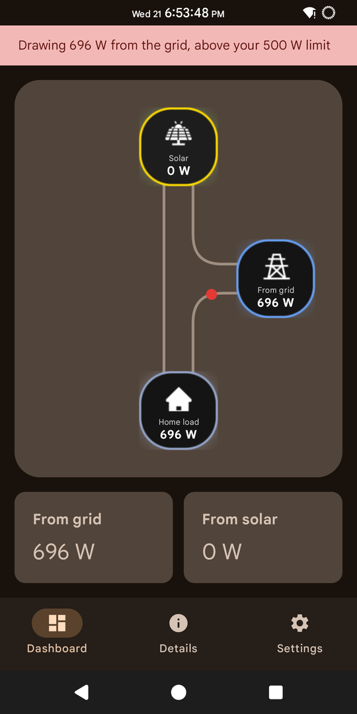
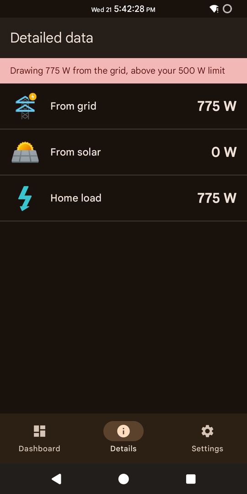
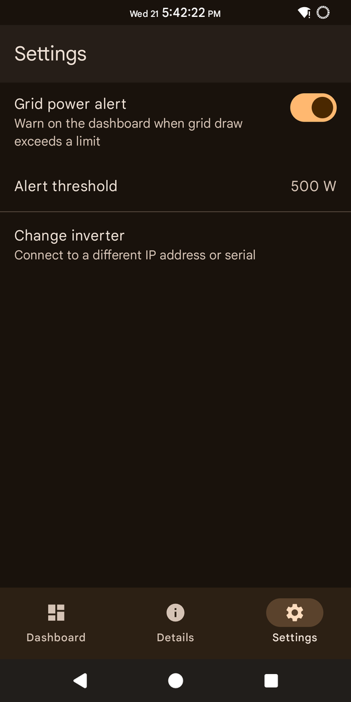
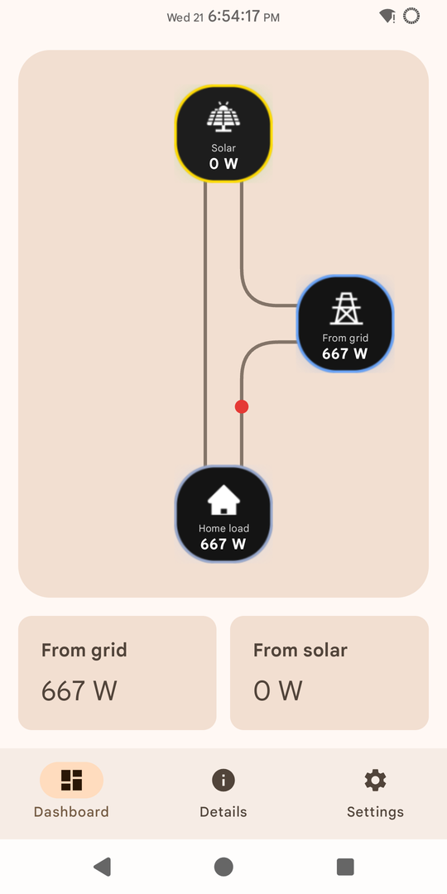
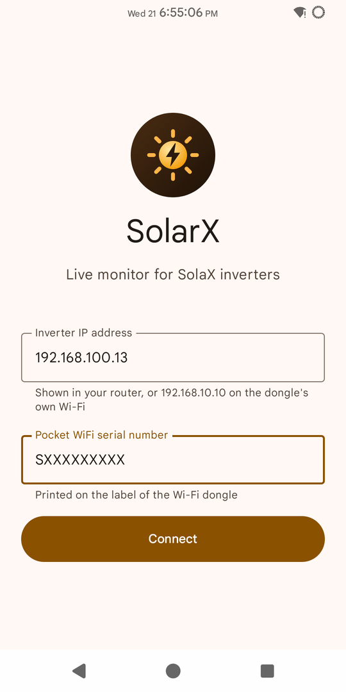
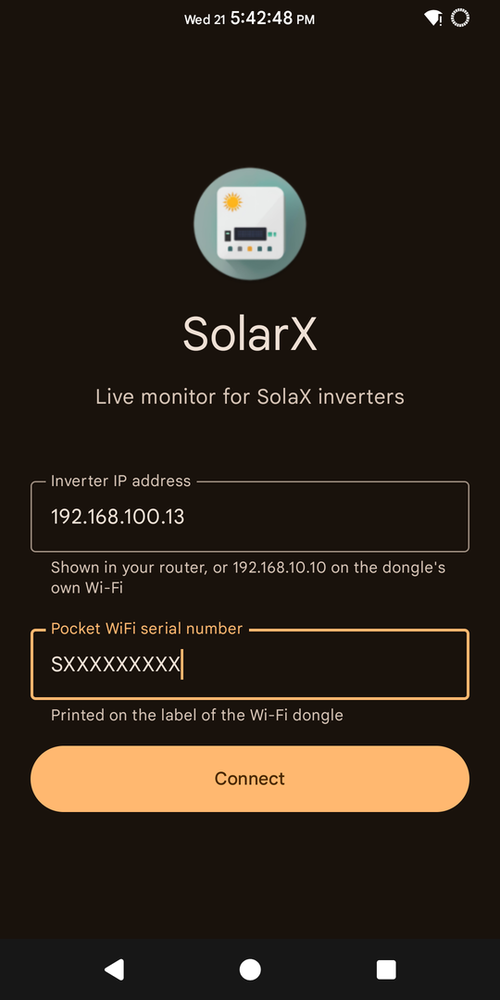
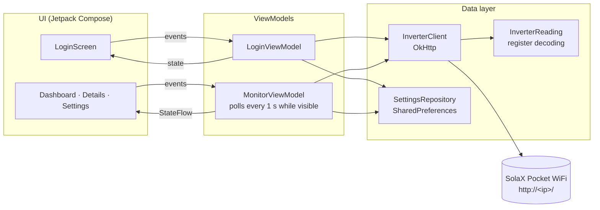

<div align="center">




# SolarX

**A real-time Android monitor for SolaX solar inverters: live energy flow, grid import/export and a configurable grid-power alert, straight from the inverter over your local network.**

[](https://github.com/AnnusShahzad/SolarXApp/actions/workflows/ci.yml)
[](https://github.com/AnnusShahzad/SolarXApp/actions/workflows/codeql.yml)
[](https://github.com/AnnusShahzad/SolarXApp/releases/latest)


[](LICENSE)
[](CONTRIBUTING.md)

[Download APK](https://github.com/AnnusShahzad/SolarXApp/releases/latest) · [Screenshots](#screenshots) · [Architecture](#architecture) · [Contributing](CONTRIBUTING.md) · [Changelog](CHANGELOG.md)

</div>

## Overview

SolaX inverters ship with a Pocket WiFi dongle that uploads data to the vendor cloud, where the app refreshes only every few minutes. The dongle also has an undocumented local HTTP API. SolarX talks to that API directly, so you see what your system is doing **right now**: how much the panels produce, whether you are exporting to or importing from the grid (WAPDA), and what the house is consuming. It updates every second, works without an internet connection, and needs no cloud account.

## Features

| Feature | What it does |
| --- | --- |
| **Live energy flow** | Solar, grid and home-load tiles show their readings, and animated dots on the wires show which way power is moving. Readings refresh every second. |
| **Grid power alert** | Set a limit in watts, and a warning banner appears whenever the house draws more than that from the grid. Useful for spotting heavy loads during load-shedding hours or on expensive tariffs. |
| **Details view** | Grid exchange, solar output and home load at a glance. |
| **Resilient polling** | When the inverter drops off the network, the last reading stays on screen with an offline banner, and polling resumes automatically. Polling pauses when the app is in the background to save battery. |
| **Clear connection errors** | Separate messages for a missing field, an invalid address, a rejected serial and an unreachable inverter. |
| **Private by design** | No backend, analytics or cloud. The saved serial (the dongle's password) is excluded from backups and device transfers. |
| **Light and dark themes** | Material 3 styling that adapts to large system fonts, landscape and split screen, with accessibility labels on the diagram and status banners. |

## Screenshots

Captured on a Pixel 3 (Android 15) connected to a real SolaX inverter, so the readings are live, not mock data.

| Dashboard with grid alert | Details | Settings |
| --- | --- | --- |
|  |  |  |
| **Dashboard, light theme** | **Connect, light theme** | **Connect, dark theme** |
|  |  |  |

Every screen also has a [Paparazzi screenshot test](app/src/test/java/io/github/annusshahzad/solarx/ui/ScreenshotTest.kt), so layout changes are caught in CI.

## Tech stack

- **Language & UI:** Kotlin, Jetpack Compose, Material 3, Navigation Compose
- **Architecture:** MVVM with unidirectional data flow, `StateFlow`, Kotlin coroutines and lifecycle-aware collection
- **Networking:** OkHttp with LAN-tuned timeouts, `org.json`
- **Testing:** JUnit 4, OkHttp MockWebServer, Paparazzi screenshot tests
- **Tooling:** Gradle Kotlin DSL with a version catalog, R8, Android lint, GitHub Actions, CodeQL, Dependabot

## Architecture



- **Screens are stateless.** Each `*Screen` composable receives a state object and callbacks, and only the thin `*Route` wrappers touch ViewModels. Every screen can therefore be previewed and screenshot-tested without a device.
- **One poller, lifecycle-aware.** `MonitorViewModel` exposes a single `StateFlow` built with `stateIn(WhileSubscribed(5 s))`. The Dashboard and Details tabs share it, it survives rotation, and it stops polling shortly after the app leaves the screen.
- **Failures are data, not crashes.** `InverterClient` reports every network or protocol problem as an `IOException`, which the ViewModels turn into an offline state or a specific login error.

```
app/src/main/java/io/github/annusshahzad/solarx/
├── data/
│   ├── InverterClient.kt      # Local API calls: verify serial, read real-time data
│   ├── InverterReading.kt     # Register decoding (signed 32-bit grid power, home load)
│   └── SettingsRepository.kt  # Saved connection and grid alert
├── ui/
│   ├── login/                 # Connection screen + LoginViewModel
│   ├── monitor/               # Dashboard, details, settings, energy-flow diagram + MonitorViewModel
│   └── theme/                 # Material 3 colours and typography
├── MainActivity.kt            # Navigation between login and home
└── SolarXApplication.kt       # App-wide dependencies
```

### How the inverter API works

The dongle accepts form POSTs on its root URL:

| Request | Body | Response |
| --- | --- | --- |
| Verify serial | `optType=newParaSetting&subOption=pwd&Value=<serial>` | `Y` when the serial is accepted |
| Real-time data | `optType=ReadRealTimeData&pwd=<serial>` | JSON with a `Data` array of 16-bit registers |

SolarX reads solar power from `Data[9]`, and grid power from the signed 32-bit pair `Data[29]`/`Data[30]` in tenths of a watt (positive means exporting). Home load is solar minus export. Register positions vary between inverter families, so they are kept in one place, [`InverterReading.kt`](app/src/main/java/io/github/annusshahzad/solarx/data/InverterReading.kt).

## Getting started

### Install the app

1. Download the latest APK from [Releases](https://github.com/AnnusShahzad/SolarXApp/releases/latest) and install it on an Android 10+ phone.
2. Connect the phone to the same Wi-Fi network as the inverter's Pocket WiFi dongle. You can also join the dongle's own access point, where it is reachable at `192.168.10.10`.
3. Enter the dongle's IP address and the serial number printed on its label, then tap **Connect**.

### Build from source

Requires Android Studio (or the Android SDK with platform 37) and JDK 21+.

```bash
git clone https://github.com/AnnusShahzad/SolarXApp.git
cd SolarXApp
./gradlew installDebug   # build and install on a connected device
```

## Testing

```bash
./gradlew testDebugUnitTest    # unit tests
./gradlew verifyPaparazziDebug # unit tests + screenshot comparison
./gradlew lintDebug            # Android lint
```

- **Register decoding:** grid power is checked against the app's original conversion formula for thousands of register pairs, covering both export and import.
- **HTTP client:** MockWebServer verifies the exact form bodies sent to the dongle, and that HTTP errors, malformed JSON, short data arrays and unreachable hosts all surface as `IOException`.
- **UI logic:** login validation, grid-alert triggering and threshold parsing.
- **Screenshots:** every screen and state (exporting, importing with alert, offline in dark theme, waiting, errors), compared pixel by pixel.

CI runs all of these plus a debug build on every push and pull request, and CodeQL scans the code weekly.

## Releases

Releases follow [Semantic Versioning](https://semver.org/) and are listed in the [changelog](CHANGELOG.md). Pushing a tag such as `v1.1.0` runs the [release workflow](.github/workflows/release.yml), which runs the checks, builds a minified release APK signed with the project key (stored as repository secrets, see the workflow header) and attaches it to a GitHub release.

## Contributing

Contributions are welcome, especially reports from owners of other SolaX models. See [CONTRIBUTING.md](CONTRIBUTING.md) for setup and guidelines, and please follow the [Code of Conduct](CODE_OF_CONDUCT.md). To report a vulnerability, see [SECURITY.md](SECURITY.md).

## License

Released under the [MIT License](LICENSE).

SolarX is an independent project. It is not affiliated with or endorsed by SolaX Power, and "SolaX" is used only to describe which inverters the app works with.
